

  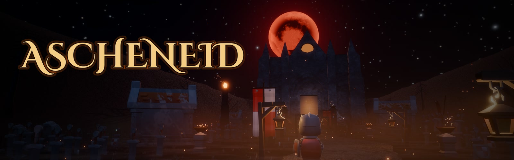

<h3 align="center"><em>Die Glut ist verloschen. Nur die Asche erinnert sich.</em></h3>

  Ein düsteres Soulslike über einen gebrochenen Eid, eine erloschene Flamme und einen Wächter, 
  der seine Gruft auch im Tod nicht verlässt. Lies den Gegner. Pariere. Steh wieder auf.

  
  &nbsp;
  
  &nbsp;
  

  
  
  
  
  

  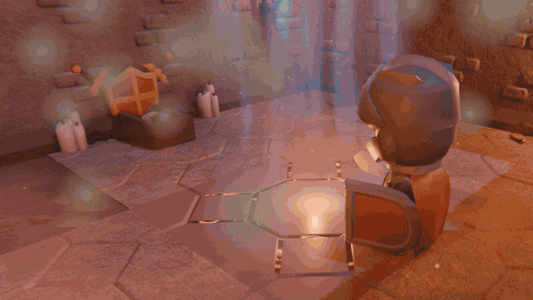

---

## Worum es geht

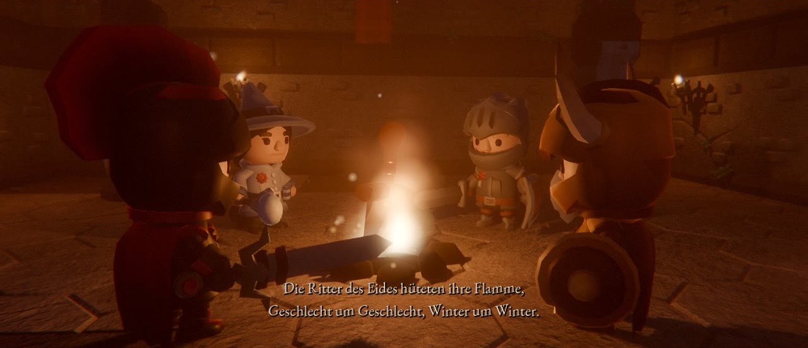

Einst brannte die Glut in allen Dingen, und die **Ritter des Eides** hüteten ihre Flamme,
Geschlecht um Geschlecht. Dann erlosch sie. Die Ritter fielen, einer nach dem anderen. Nur der
**Wächter** blieb auf seinem Thron, gehalten von einem Eid, der älter ist als sein Fleisch.

Du erwachst als *Ungebrannter* in einem offenen Sarg, tief in der Gruft. Unter dir schläft etwas,
das ein altes Siegel nicht mehr lange hält. Vor dir liegen Hallen voller Gebeine, Mauern, die lügen,
eine Truhe, die atmet, und am Ende ein Nebel, hinter dem ein Thron wartet.

**Ascheneid** ist eine abgeschlossene Demo mit Intro-Cinematic, einer Einführung in ihrer eigenen
kleinen Gruft, einem Gebiet voller Geheimnisse, einer Quest um einen gefallenen Ritter, einem Mini-Boss, einem zweiphasigen Endboss und einem
Finale, das eine Tür offen lässt.

 

## Was dich erwartet

<table>
  <tr>
    <td width="52%">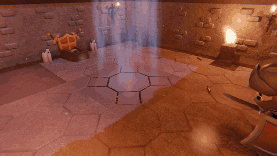</td>
    <td>
      <h3>Ein Anfang, der dich fallen lässt</h3>
      Die Einführung ist ein eigener kleiner Ort: die <b>Gruft des Erwachens</b>. Dort lernst du
      an Puppe und Übungswächter, was du brauchst. Dann hebt sich ein Gitter zur Siegelkammer. Tritt auf das
      Siegel der Eidritter, und tief unten brüllt etwas. Die Gruft bebt, die Risse glühen auf, und
      <b>der Boden bricht ein</b>. Wer die Einführung nicht braucht, beginnt gleich unten.
    </td>
  </tr>
  <tr>
    <td>
      <h3>Kämpfe, die man lesen kann</h3>
      Kurz vor jedem Treffer glühen die Augen der Gegner auf, dann blitzt ein Stern. Das ist dein
      Moment: Parade, Taumeln, <b>kritischer Stoß</b>. Rot blitzende Angriffe lassen sich nicht
      parieren, dann heißt es ausweichen. Dazu kommen Rückenstich, Sturzangriff aus der Höhe,
      Lock-on mit Zielwechsel und Trefferstopp, der jedem Schlag Gewicht gibt.
    </td>
    <td width="52%">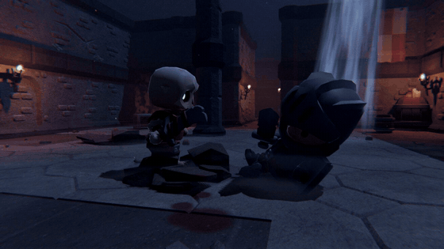</td>
  </tr>
  <tr>
    <td width="52%">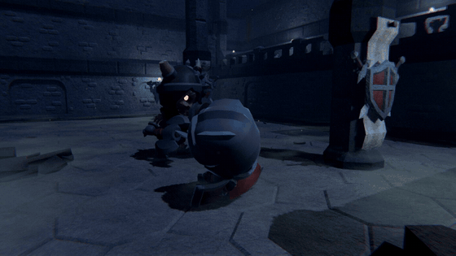</td>
    <td>
      <h3>Ein Dash, der sich wie einer anfühlt</h3>
      Explosiver Antritt, Körper in der Bewegung, leuchtende <b>Nachbilder</b> in der Spur. Solange
      du unverwundbar bist, schimmert die Figur bläulich, das Zeitfenster ist sichtbar statt geraten.
      Ausdauer entscheidet über jeden Angriff, jede Parade und jeden Dash.
    </td>
  </tr>
  <tr>
    <td>
      <h3>Klinge im Wurf</h3>
      <b>Wurfmesser</b> holen Zauberer aus dem Konzept, wecken schlafende Skelette einzeln statt die
      ganze Gruppe, decken Scheinmauern aus sicherer Entfernung auf und lassen eine gewisse Truhe
      erwachen, bevor sie zubeißt. Doch der Vorrat ist endlich: Nachschub tragen nur die Gebeine,
      die du erschlägst, und der Gurt fasst nicht mehr als zehn.
    </td>
    <td width="52%">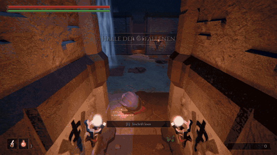</td>
  </tr>
  <tr>
    <td width="52%">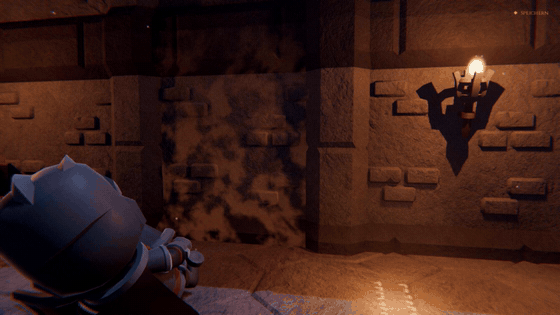</td>
    <td>
      <h3>Eine Gruft voller Geheimnisse</h3>
      Manche Mauern lügen. Ein ganz leichter Glutschimmer verrät sie, und ein Schlag lässt sie
      zu Asche zerfallen. Dahinter liegen verborgene Kapellen, eine Abkürzung, die man erst von der anderen
      Seite öffnet, und eine Truhe, die man besser nicht öffnet. Gefundene
      <b>Glutsplitter</b> schmilzt du am Glutfeuer ein: für einen weiteren Flakon oder eine härtere Klinge.
    </td>
  </tr>
  <tr>
    <td>
      <h3>Bosse mit Auftritt</h3>
      <b>Hrodgar, der Grabschänder</b> sitzt auf der Beute aus den Gräbern, die er hüten sollte, und
      erhebt sich brüllend mit zwei Äxten. Ab halber Kraft gerät er in Raserei. Hinter einem
      verschlossenen Kerkertor wartet er, mit eigener Musik, und er trägt etwas, das ihm nicht gehört.
    </td>
    <td width="52%">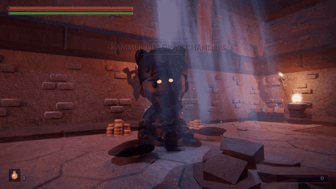</td>
  </tr>
  <tr>
    <td width="52%">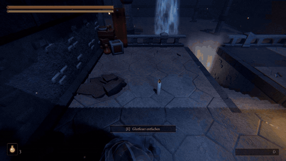</td>
    <td>
      <h3>Ein Eid, der dich begleitet</h3>
      Mitten in der Gruft sitzt <b>Ser Aldric</b>, halb tot an der Galerietreppe, gebunden an diese
      Steine. Er gibt dir einen Schlüssel und einen Auftrag. Wer ihn erfüllt, findet vor dem Nebel ein
      goldenes Rufzeichen: Glut formt Aldrics Umriss, er erhebt sich, zieht das Schwert und folgt dir
      in den letzten Kampf. Allein zu gehen bleibt erlaubt.
    </td>
  </tr>
  <tr>
    <td>
      <h3>Ein Thron hinter dem Nebel</h3>
      Der <b>Thronsaal</b> ist eine eigene Welt, abgeschlossen hinter Mauern, einem vergitterten Fenster und
      einem Torbogen voller Nebel. Drinnen brennen keine Fackeln. Aschebedeckter Stein mit glühenden Rissen,
      tiefrote Banner, die Rüstungen gefallener Eidritter, ein Feld zerbrochener Klingen. Durch das offene
      Dach fallen Asche und Mondlicht auf den Thron. Darauf sitzt der Wächter. Er erwacht, brüllt und
      <b>springt herab</b>.
    </td>
    <td width="52%">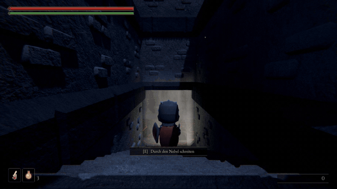</td>
  </tr>
  <tr>
    <td width="52%">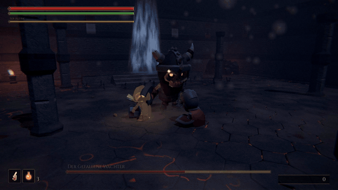</td>
    <td>
      <h3>Der Gefallene Wächter</h3>
      Er wechselt seine Ziele, wenn Aldric an deiner Seite kämpft. Bei halber Kraft dehnt sich die Zeit,
      <b>die Glutrisse im Boden lodern auf</b>, die Musik wird härter, und er entfesselt Sprungangriffe,
      Wirbelschläge und ruft die Toten herbei.
    </td>
  </tr>
  <tr>
    <td>
      <h3>Ausrüstung wie in Elden Ring</h3>
      Ein <b>Inventar</b> mit Reitern, Detailtafel und Lore zu jedem Stück, mit Controller, Tastatur
      oder Maus. Ordne deine <b>Schnellleiste</b> frei und rotiere im Kampf mit einem Tastendruck
      zwischen Schwert & Schild, Zweihänder und Wurfmessern. Ringe zeigen vorher, was sie ändern,
      etwa der Ring, den die Gierige Truhe nicht verdauen konnte.
    </td>
    <td width="52%">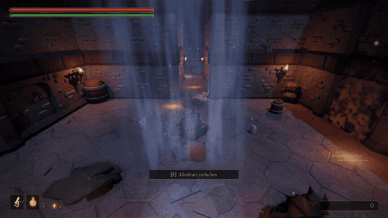</td>
  </tr>
  <tr>
    <td width="52%">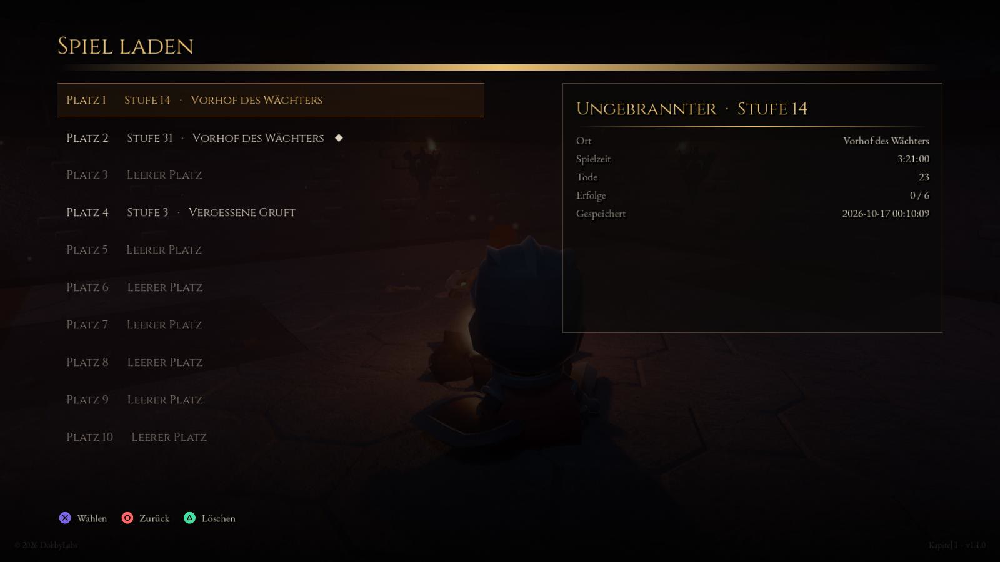</td>
    <td>
      <h3>Zehn Figuren, zehn Geschichten</h3>
      <b>Spielstände wie in Elden Ring:</b> zehn Plätze, jeder mit Stufe, Ort, Spielzeit, Durchgang und
      Toden auf einen Blick. „Fortsetzen“ bringt dich zurück zum letzten Stand. Gelöscht und überschrieben
      wird nur nach Nachfrage, und ein durchgespielter Stand führt in Neues Spiel+.
    </td>
  </tr>
</table>

## Galerie

<table>
  <tr>
    <td>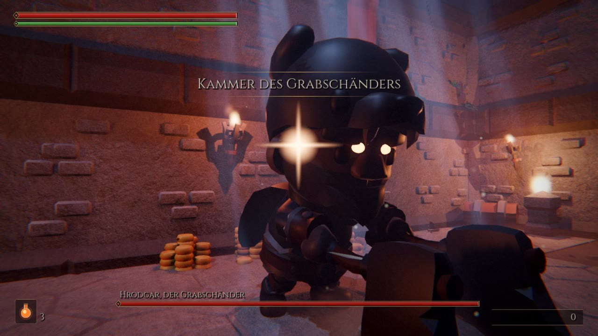</td>
    <td>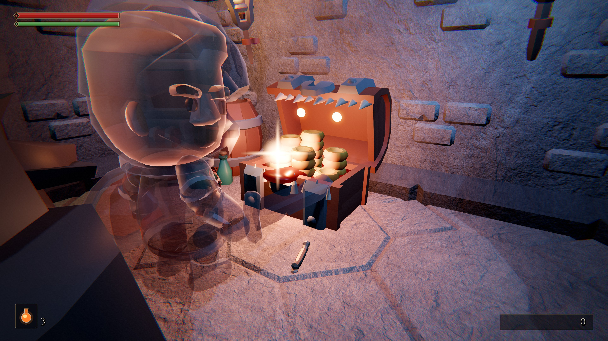</td>
    <td>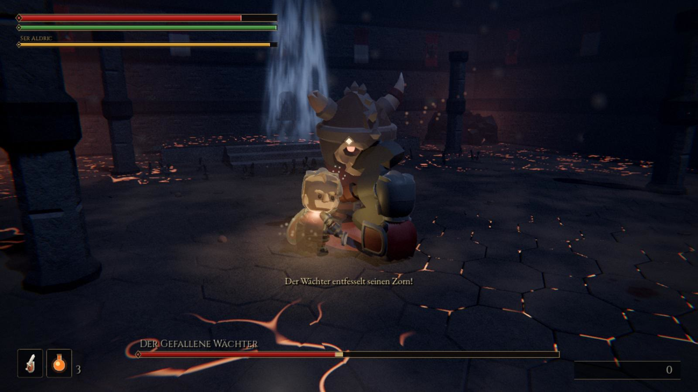</td>
  </tr>
  <tr>
    <td>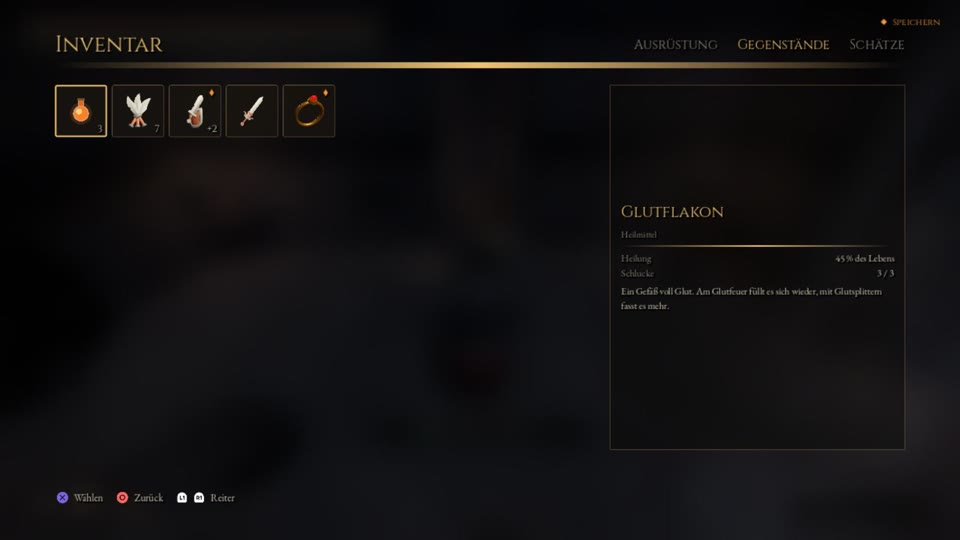</td>
    <td>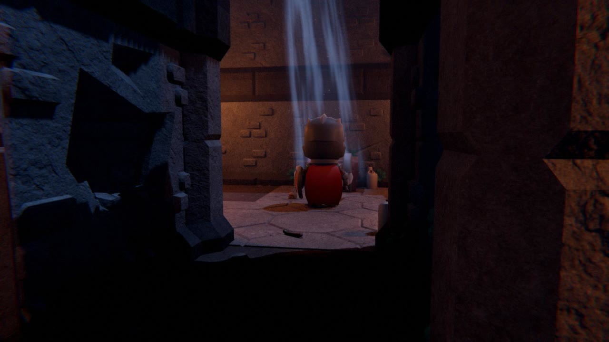</td>
    <td>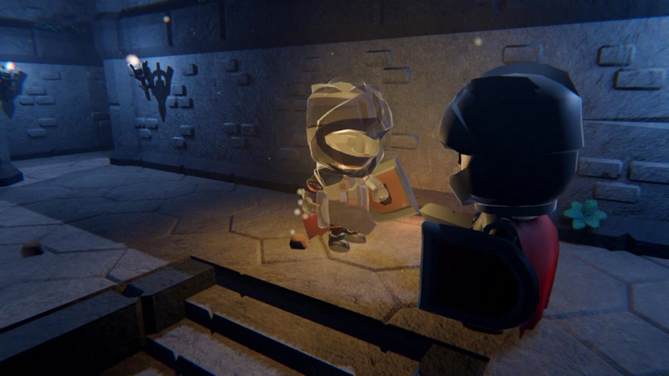</td>
  </tr>
  <tr>
    <td>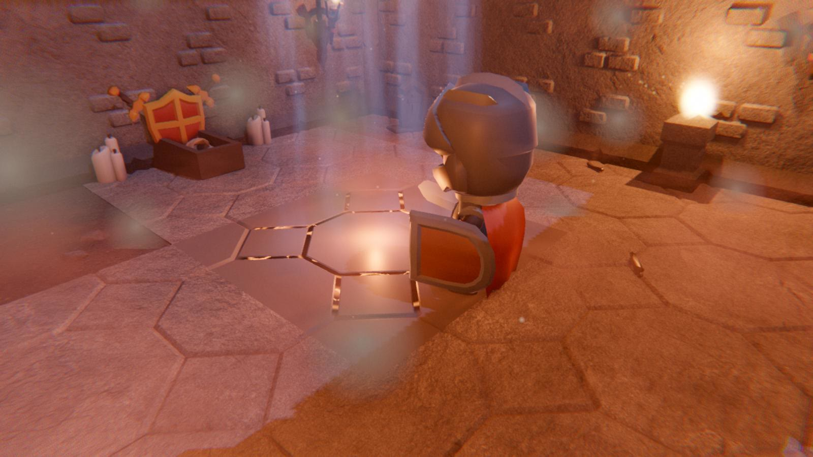</td>
    <td>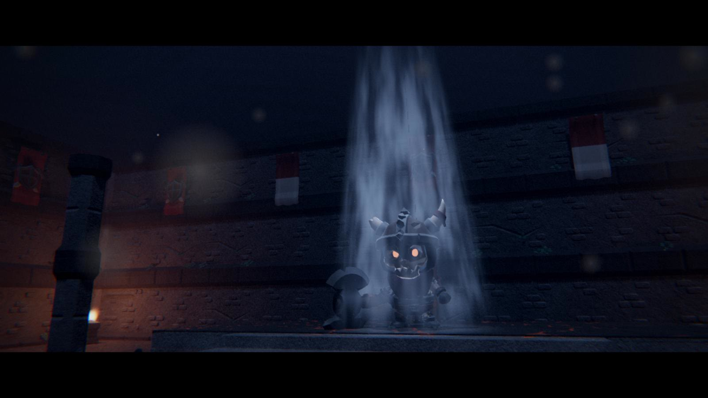</td>
    <td>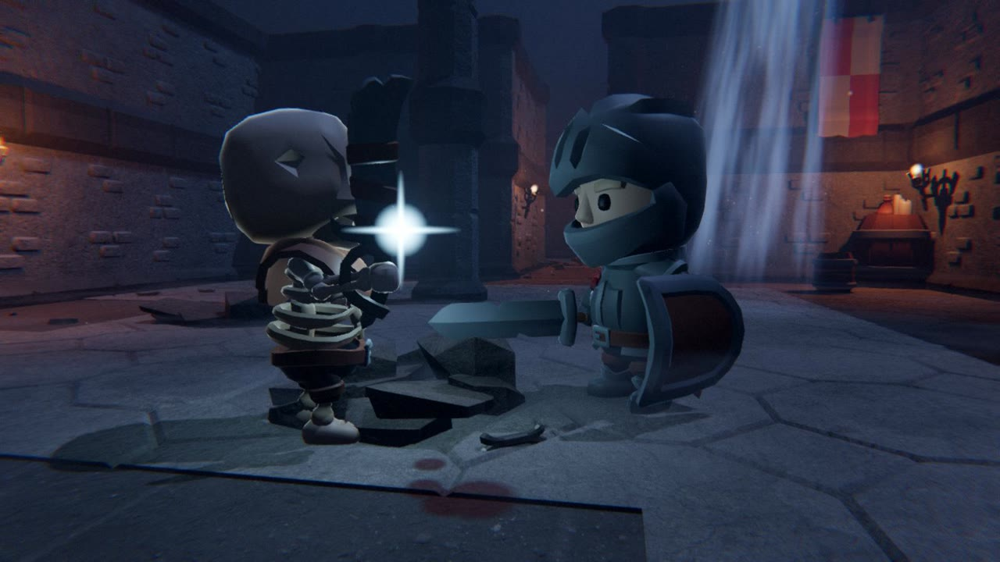</td>
  </tr>
</table>

## Alles auf einen Blick

- **Souls-Kern:** Glutfeuer als Rastpunkte, Glutflakons, Seelen und Stufenaufstieg, Blutfleck nach
  dem Tod, Abkürzungen, auferstehende Gegner, Inschriften am Boden
- **Kampf:** Leicht-Combo, schwerer Angriff, Parade mit lesbarem Signal, Riposte, Rückenstich,
  Sturzangriff, Dash mit Unverwundbarkeit, Blocken, Lock-on, zwei Waffen (Schwert & Schild oder Zweihänder),
  Wurfmesser mit endlichem Vorrat (unterbrechen Zauber, locken einzelne Gegner)
- **Gegner:** Skelettsoldaten (teils schlafend), Knochenschleicher, Skelettritter mit Schild,
  Knochenseher (Skelettmagier), die Gierige Truhe, Mini-Boss Hrodgar, Endboss mit zwei Phasen.
  Höchstens zwei Gegner greifen gleichzeitig an, die übrigen lauern
- **Quest:** Ser Aldrics Auftrag mit Schlüssel, Kamerafahrt zum Ziel, Kerkertor und einem
  Verbündeten, der im Bosskampf mitkämpft und die Aufmerksamkeit des Wächters auf sich zieht
- **Fortschritt:** drei Attribute, fünf Glutsplitter für Flakon oder Klinge (bis +3), der Ring des
  Verschlungenen, Neues Spiel+
- **Ausrüstung:** Inventar wie in Elden Ring mit Reitern, Detailtafel und Lore; Schnellleiste mit vier
  frei anordenbaren Plätzen, die man im Kampf durchrotiert
- **Inszenierung:** erzählte Intro-Cinematic, der Einsturz der Gruft des Erwachens, Boss-Auftritte
  (der Wächter springt von seinem Thron), Zeitlupe beim Tod, Abspann mit Teaser und Bilanz der Reise
- **Atmosphäre:** Mondlicht in Lichtschächten, Bodennebel je Gebiet, echte Steinoberflächen,
  flackernde Fackeln, ein Thronsaal mit eigener Farbwelt, Glutrissen und Wind statt Musik,
  Raumhall nach Raumgröße, Schritte je nach Untergrund, Orchestermusik
- **Einführung:** ein eigener kleiner Ort, die Gruft des Erwachens, mit geführtem Tutorial und
  Tastenhinweisen für Tastatur oder Gamepad; jederzeit überspringbar
- **Spielstände:** zehn Plätze wie in Elden Ring, mit Tafel (Ort, Spielzeit, Durchgang, Tode),
  Löschen und Überschreiben nur nach Nachfrage
- **Controller:** Xbox, PlayStation und Steam Deck werden erkannt; überall erscheinen die passenden
  Tastensymbole. Belegung wie in Elden Ring
- **Komfort:** frei belegbare Tasten, Pausemenü mit Steuerungsübersicht für das gerade benutzte
  Gerät, Grafikstufen passend zur Hardware (auch für das Steam Deck), Kamera, die nicht an Wänden
  klebt, die eigene Figur wird halb durchsichtig, wenn sie dir die Sicht auf den Gegner nimmt;
  Updates aus dem Spiel heraus, nach Nachfrage und mit Downloadbalken

## Spielen

1. Unter [**Releases**](https://github.com/KrabbiAI/Ascheneid/releases/latest) die Datei für
   dein System herunterladen.
2. Entpacken und starten.

| System | Datei | Start |
|---|---|---|
| Windows 10/11 (64 Bit) | `Ascheneid-Windows.zip` | `Ascheneid.exe` starten (`.exe` und `.pck` im selben Ordner lassen) |
| macOS 11+ (Intel & Apple Silicon) | `Ascheneid-macOS.zip` | `Ascheneid.app` per **Rechtsklick → Öffnen** starten |
| Linux (x86_64) & Steam Deck | `Ascheneid-Linux.zip` | `Ascheneid.x86_64` starten (`.x86_64` und `.pck` im selben Ordner lassen) |

**Steam Deck:** Im Desktop-Modus die Zip herunterladen und entpacken, z. B. nach
`~/Games/Ascheneid`. Dann in Steam *Spiele → Nicht-Steam-Spiel zur Bibliothek hinzufügen* →
*Durchsuchen* → `Ascheneid.x86_64` wählen. Zurück im Spielmodus startet Ascheneid aus der
Bibliothek, im Vollbild, mit Steam-Deck-Tastensymbolen und einer Grafikstufe für den Akku
(60 Bilder pro Sekunde, FSR). Unter Linux gilt dasselbe: entpacken, starten; startet die Datei nicht,
hilft `chmod +x Ascheneid.x86_64`.

**macOS:** Die App ist nicht von Apple notarisiert. Beim ersten Start: Rechtsklick auf die App →
*Öffnen* → *Öffnen*. Hilft das nicht: Systemeinstellungen → Datenschutz & Sicherheit →
*Trotzdem öffnen*, oder im Terminal `xattr -cr Ascheneid.app`.

**Leistung:** Das Spiel wählt beim ersten Start eine Grafikstufe passend zur Hardware. Ruckelt es
auf einem älteren Laptop oder Mac: *Optionen → Grafik → Stufe 0*.

**Updates (ab v0.8.2):** Beim Start schaut das Spiel nach, ob es eine neue Version gibt, und fragt im
Titelmenü, ob sie geladen werden soll. Ein Balken zeigt den Download; Größe und Prüfsumme werden mit
GitHub abgeglichen. Danach genügt *Neu starten und aktualisieren* (Linux und Steam Deck: *Beenden und
aktualisieren*), sonst wird beim Beenden installiert. Spielstände und Einstellungen bleiben erhalten.
Abschalten unter *Optionen → Spiel → Nach Updates suchen*. Auf dem Mac muss die App dafür in einem
beschreibbaren Ordner liegen, etwa in *Programme*. Ältere Versionen einmal von Hand durch v0.8.2 ersetzen.

### Steuerung

Die Controller-Belegung folgt Elden Ring. Das Spiel erkennt den Controller und zeigt die passenden
Symbole; wer die Steuerung vergisst, findet sie im Pausemenü.

| Aktion | Tastatur/Maus | Xbox / Steam Deck | PlayStation |
|---|---|---|---|
| Bewegen / Kamera | WASD / Maus | Linker / rechter Stick | Linker / rechter Stick |
| Ausweichen (Dash) | Leertaste | B tippen | Kreis tippen |
| Sprinten | Umschalt halten | B halten (oder L3) | Kreis halten (oder L3) |
| Leichter / schwerer Angriff | Linke Maustaste / Q | RB / RT (Deck: R1 / R2) | R1 / R2 |
| Blocken / Parieren | Rechte Maustaste / F | LB / LT (Deck: L1 / L2) | L1 / L2 |
| Glutflakon | R | X | Quadrat |
| Interagieren | E | Y | Dreieck |
| Ziel fixieren / wechseln | Tab, Mausrad / Maus seitlich | R3 / rechter Stick | R3 / rechter Stick |
| Schnellleiste vor / zurück | C / X, Mausrad, 1–4 | Steuerkreuz rechts / links | Steuerkreuz rechts / links |
| Werfen (Messer in der Hand) | Linke Maustaste | RB | R1 |
| Inventar | I | Ansicht | Create |
| Pause | Esc | Menü | Options |

Alle Tastatur- und Mausbelegungen lassen sich unter *Optionen → Steuerung* ändern.

## Mitwirkende

Entwickelt von **DobbyLabs** mit Claude (Anthropic), gebaut mit der [Godot Engine](https://godotengine.org).
Modelle von Kay Lousberg (KayKit) und Quaternius, Texturen von Poly Haven, Musik von cynicmusic,
Cethiel, yd und César da Rocha, Klänge und Tastensymbole von Kenney. Alle Quellen und Lizenzen stehen in
[CREDITS.md](CREDITS.md).

