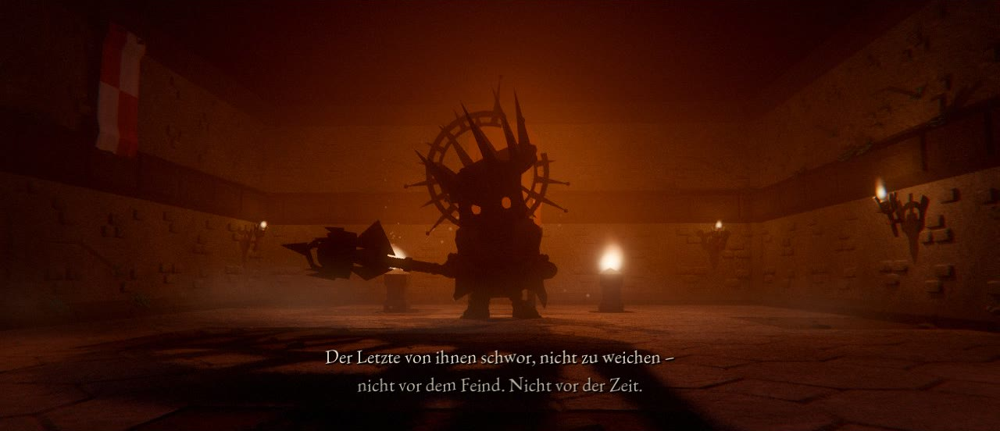
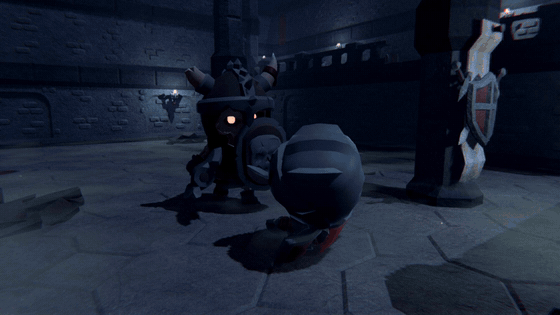
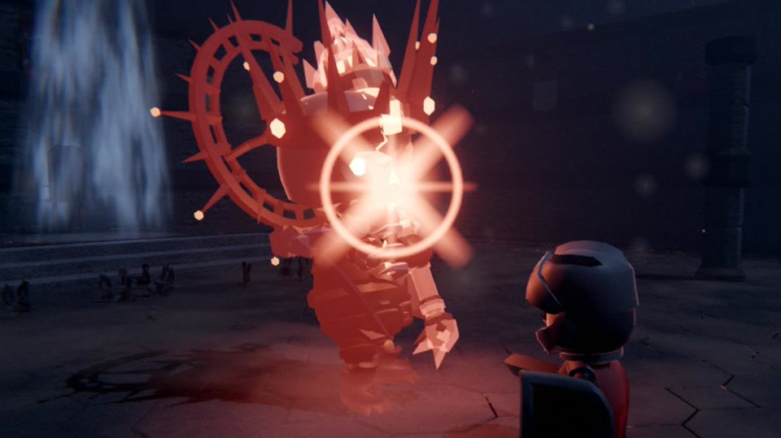
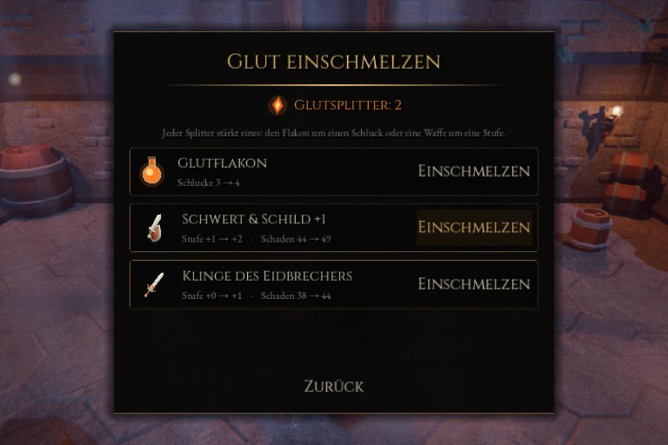
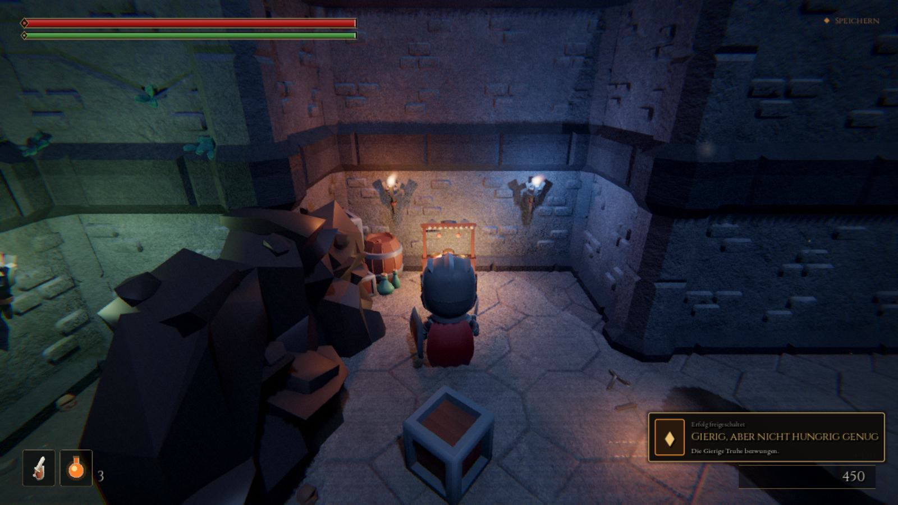

  

<h3 align="center"><em>Die Glut ist erloschen. Nur die Asche erinnert sich.</em></h3>

  Ein düsteres Soulslike in einer Gruft, die ihre Toten nicht hergibt. 
  Lies den Gegner. Pariere. Fall. Steh wieder auf.

  
  &nbsp;
  
  &nbsp;
  

  
  
  
  
  

  

---

## Über das Spiel

Einst brannte die Glut in allen Dingen, und die **Ritter des Eides** hüteten ihre Flamme, Geschlecht um
Geschlecht, Winter um Winter. Dann erlosch sie. Am letzten Feuer zerfielen die Eidbrüder zu Asche, einer
nach dem anderen. Nur einer blieb zurück.

Der Letzte von ihnen schwor, nicht zu weichen. Nicht vor dem Feind, nicht vor der Zeit. Tief unten in
der Gruft harrt er noch immer auf seinem Thron aus, und was einst ein Wächter war, trägt nun eine
gesprungene Krone.

Du erwachst als *Ungebrannter* in einem offenen Sarg. Vor dir liegen Hallen voller Gebeine, Mauern,
die lügen, eine Truhe, die atmet, ein sterbender Ritter mit einem letzten Auftrag. Und am Ende ein
Nebel, hinter dem ein Thron wartet.

**Ascheneid 1.0** ist das erste abgeschlossene Kapitel – kostenlos, rund 40 Minuten lang: mit erzähltem Intro,
einer eigenen kleinen Einführung, einem Gebiet voller Geheimnisse, einem Mini-Boss, einem zweiphasigen
Endboss und einem Finale, das eine Tür offen lässt.

 

   
  <em>„Der Letzte von ihnen schwor, nicht zu weichen – nicht vor dem Feind. Nicht vor der Zeit.“</em>

## Neu in 1.0

- **Das Urteil der Krone:** Der Wächter hat schon in Phase 1 einen roten Angriff. Er glüht am ganzen Körper
  rot auf, während er das Kronzepter über den Kopf reißt – parieren hilft nicht, ausweichen schon.
- **Ausgewogener Endkampf:** fordernd, aber fair – auch wer nicht jede Parade trifft, hat eine Chance.
- **Ser Aldric erneuert seinen Eid,** wenn der Wächter in Raserei verfällt, und schöpft neue Kraft.
- **Ein klarer Sturz:** Beim Einsturz der Gruft verdeckt kein Staubschleier mehr den Fall, und wie jede
  Zwischensequenz lässt er sich mit einer gehaltenen Taste überspringen.

Alle Änderungen stehen im [CHANGELOG](CHANGELOG.md).

## Das erwartet dich

<table>
  <tr>
    <td width="52%"></td>
    <td>
      <h3>Der Boden gibt nach</h3>
      Die Gruft des Erwachens bringt dir bei, was du brauchst. Dann trittst du auf das Siegel der Eidritter.
      Tief unten brüllt etwas, die Risse glühen auf, die Platten zerspringen, und du <b>stürzt in die
      glühende Tiefe</b>. Ab hier gibt es keinen Weg zurück.
    </td>
  </tr>
  <tr>
    <td>
      <h3>Lies den Gegner</h3>
      Kurz vor jedem Hieb glühen die Augen der Gegner auf, dann blitzt ein Stern: dein Moment.
      Eine Parade bringt sie ins Taumeln und öffnet sie für den <b>kritischen Stoß</b>. Rückenstich,
      Sturzangriff aus der Höhe und Trefferstopp geben jedem Schlag Gewicht.
    </td>
    <td width="52%"></td>
  </tr>
  <tr>
    <td width="52%"></td>
    <td>
      <h3>Rot heißt: weg da</h3>
      Manche Angriffe lassen sich nicht parieren. Dann <b>glüht die Waffe rot</b>, statt des Sterns
      warnt ein roter Kreuzblitz, und ein tiefes Dröhnen kündigt den Schlag an. Blocken kostet viel Kraft,
      also lieber ausweichen.
    </td>
  </tr>
  <tr>
    <td>
      <h3>Jede Bewegung kostet Kraft</h3>
      Explosiver Antritt, leuchtende <b>Nachbilder</b>, und solange du unverwundbar bist, schimmert die
      Figur bläulich: Das Zeitfenster ist sichtbar statt geraten. Doch jeder Hieb und jeder Dash zehrt an der
      Ausdauer. Wer sich verausgabt, gerät <b>außer Atem</b> und muss verschnaufen.
    </td>
    <td width="52%"></td>
  </tr>
  <tr>
    <td width="52%"></td>
    <td>
      <h3>Klinge im Wurf</h3>
      <b>Wurfmesser</b> reißen Zauberer aus ihrem Spruch, locken schlafende Skelette einzeln aus der
      Gruppe und decken Scheinmauern aus sicherer Entfernung auf. Doch der Gurt fasst nur zehn, und
      Nachschub tragen nur die Gebeine, die du erschlägst.
    </td>
  </tr>
  <tr>
    <td>
      <h3>Mauern, die lügen</h3>
      Ein ganz leichter Glutschimmer verrät sie, ein Schlag lässt sie zu Asche zerfallen. Dahinter warten
      verborgene Kapellen, Abkürzungen und eine Truhe, die man besser nicht öffnet. Gefundene
      <b>Glutsplitter</b> schmilzt du am Glutfeuer ein: für einen weiteren Schluck aus dem Flakon oder eine
      härtere Klinge.
    </td>
    <td width="52%"></td>
  </tr>
  <tr>
    <td width="52%"></td>
    <td>
      <h3>Der Grabschänder</h3>
      Hinter einem verschlossenen Kerkertor sitzt <b>Hrodgar</b> auf dem Gold aus den Gräbern, die er
      hüten sollte. Kommst du näher, erhebt er sich brüllend mit zwei Äxten, und bei halber Kraft gerät
      er in Raserei. Er trägt etwas, das ihm nicht gehört.
    </td>
  </tr>
  <tr>
    <td>
      <h3>Ein Eid, der dich begleitet</h3>
      In einer leicht übersehenen Nische sitzt <b>Ser Aldric</b>, ein Eidritter, halb tot und an diese
      Steine gebunden. Er gibt dir einen Schlüssel und einen Auftrag. Erfüllst du ihn, glimmt vor dem
      Nebel sein goldenes Rufzeichen: Er erhebt sich als Phantom und zieht mit dir in den letzten Kampf. Verfällt
      der Wächter in Raserei, erneuert Aldric seinen Eid.
    </td>
    <td width="52%"></td>
  </tr>
  <tr>
    <td width="52%"></td>
    <td>
      <h3>Hinter dem Nebel</h3>
      Der Thronsaal liegt im Dunkeln. Eine Feuerschale nach der anderen entflammt, in der Krone des
      Wächters kehrt die Glut zurück, seine Augen lodern auf. Er rammt sein Zepter in den Boden, die
      Glutrisse brennen bis zu deinen Füßen, und er <b>springt herab</b>.
    </td>
  </tr>
  <tr>
    <td>
      <h3>Der Gekrönte Wahn</h3>
      Ein Skelettkönig mit gesprungener Krone, einem glühenden Herzen im offenen Brustkorb und dem
      <b>Kronzepter</b> in der Hand. Bei halber Kraft dehnt sich die Zeit, der Boden lodert, und er ruft
      die Toten herbei. Solange er brüllt und beschwört, schützt ihn ein Glutschild. Glüht er rot auf,
      holt er zum <b>Urteil der Krone</b> aus – keine Parade hält es auf, nur ein Sprung zur Seite.
    </td>
    <td width="52%"></td>
  </tr>
  <tr>
    <td width="52%"></td>
    <td>
      <h3>Ausrüstung mit Geschichte</h3>
      Jedes Stück hat seine eigene Lore. Wechsle im Kampf mit einem Tastendruck zwischen Schwert und
      Schild und Wurfmessern, lege den Ring an, den die Gierige Truhe nicht verdauen konnte,
      und bring deine Figur in <b>Neues Spiel+</b>.
    </td>
  </tr>
</table>

## Galerie

<table>
  <tr>
    <td></td>
    <td></td>
    <td></td>
    <td></td>
  </tr>
  <tr>
    <td></td>
    <td></td>
    <td></td>
    <td></td>
  </tr>
  <tr>
    <td></td>
    <td></td>
    <td></td>
    <td></td>
  </tr>
</table>

## Auf einen Blick

- **Kämpfe, die man lesen kann:** Parade mit klarem Signal, kritische Stöße, Rückenstich, Sturzangriff,
  Dash mit sichtbarer Unverwundbarkeit, rote Angriffe, denen man ausweichen muss
- **Schwert und Schild, dazu Wurfmesser,** im Kampf per Schnellleiste gewechselt
- **Glutfeuer, Seelen, Blutfleck:** Rasten heilt und weckt die Toten, Stufen machen dich stärker, wer fällt,
  holt seine Seelen zurück
- **Eine Gruft voller Geheimnisse:** Scheinmauern, Abkürzungen, eine Truhe, die beißt, und Inschriften am Boden
- **Zwei Bosse mit Auftritt** und ein Verbündeter, den du in den letzten Kampf rufen kannst
- **Zehn Spielstände, sechs Erfolge** je Spielstand und Neues Spiel+
- **Mit Controller gedacht:** Xbox, PlayStation und Steam Deck werden erkannt, überall erscheinen die
  passenden Tastensymbole; Tastatur und Maus frei belegbar
- **Läuft auch unterwegs:** Grafikstufen passend zur Hardware, eine eigene für das Steam Deck; Updates
  kommen auf Nachfrage direkt im Spiel

## Systemanforderungen

| | Mindestens | Empfohlen |
|---|---|---|
| **System** | Windows 10 (64 Bit), macOS 11, Linux (x86_64), Steam Deck | Windows 11, macOS 13 |
| **Grafik** | Integrierte Grafik mit Vulkan (Mac: Metal) | Eigene Grafikkarte |
| **Arbeitsspeicher** | 4 GB | 8 GB |
| **Speicherplatz** | ca. 200 MB | ca. 200 MB |
| **Eingabe** | Tastatur und Maus | Controller (Xbox, PlayStation oder Steam Deck) |

## Spielen

1. Unter [**Releases**](https://github.com/KrabbiAI/Ascheneid/releases/latest) die Datei für
   dein System herunterladen.
2. Entpacken und starten.

| System | Datei | Start |
|---|---|---|
| Windows 10/11 (64 Bit) | `Ascheneid-Windows.zip` | `Ascheneid.exe` starten (`.exe` und `.pck` im selben Ordner lassen) |
| macOS 11+ (Intel & Apple Silicon) | `Ascheneid-macOS.zip` | `Ascheneid.app` per **Rechtsklick → Öffnen** starten |
| Linux (x86_64) & Steam Deck | `Ascheneid-Linux.zip` | `Ascheneid.x86_64` starten (`.x86_64` und `.pck` im selben Ordner lassen) |

**Steam Deck:** Im Desktop-Modus die Zip herunterladen und entpacken, z. B. nach
`~/Games/Ascheneid`. Dann in Steam *Spiele → Nicht-Steam-Spiel zur Bibliothek hinzufügen* →
*Durchsuchen* → `Ascheneid.x86_64` wählen. Zurück im Spielmodus startet Ascheneid aus der
Bibliothek, im Vollbild, mit Steam-Deck-Tastensymbolen und einer Grafikstufe für den Akku
(60 Bilder pro Sekunde, FSR). Unter Linux gilt dasselbe: entpacken, starten; startet die Datei nicht,
hilft `chmod +x Ascheneid.x86_64`.

**macOS:** Die App ist nicht von Apple notarisiert. Beim ersten Start: Rechtsklick auf die App →
*Öffnen* → *Öffnen*. Hilft das nicht: Systemeinstellungen → Datenschutz & Sicherheit →
*Trotzdem öffnen*, oder im Terminal `xattr -cr Ascheneid.app`.

**Leistung:** Das Spiel wählt beim ersten Start eine Grafikstufe passend zur Hardware. Ruckelt es
auf einem älteren Laptop oder Mac: *Optionen → Grafik → Stufe 0*.

**Updates:** Beim Start schaut das Spiel nach einer neuen Version und fragt im Titelmenü, ob sie geladen
werden soll. Ein Balken zeigt den Download, Größe und Prüfsumme werden mit GitHub abgeglichen. Danach
genügt *Neu starten und aktualisieren* (Linux und Steam Deck: *Beenden und aktualisieren*), sonst wird beim
Beenden installiert. Spielstände und Einstellungen bleiben erhalten. Abschalten unter *Optionen → Spiel →
Nach Updates suchen*. Auf dem Mac muss die App dafür in einem beschreibbaren Ordner liegen, etwa in
*Programme*. Versionen vor v0.8.2 einmal von Hand ersetzen.

### Steuerung

Die Controller-Belegung folgt dem Soulslike-Standard. Das Spiel erkennt den Controller und zeigt die passenden
Symbole; wer die Steuerung vergisst, findet sie im Pausemenü.

| Aktion | Tastatur/Maus | Xbox / Steam Deck | PlayStation |
|---|---|---|---|
| Bewegen / Kamera | WASD / Maus | Linker / rechter Stick | Linker / rechter Stick |
| Ausweichen (Dash) | Leertaste | B tippen | Kreis tippen |
| Sprinten | Umschalt halten | B halten (oder L3) | Kreis halten (oder L3) |
| Leichter / schwerer Angriff | Linke Maustaste / Q | RB / RT (Deck: R1 / R2) | R1 / R2 |
| Blocken / Parieren | Rechte Maustaste / F | LB / LT (Deck: L1 / L2) | L1 / L2 |
| Glutflakon | R | X | Quadrat |
| Interagieren | E | Y | Dreieck |
| Ziel fixieren / wechseln | Tab, Mausrad / Maus seitlich | R3 / rechter Stick | R3 / rechter Stick |
| Schnellleiste vor / zurück | C / X, Mausrad, 1–4 | Steuerkreuz rechts / links | Steuerkreuz rechts / links |
| Werfen (Messer in der Hand) | Linke Maustaste | RB | R1 |
| Inventar | I | Ansicht | Create |
| Pause | Esc | Menü | Options |

Alle Tastatur- und Mausbelegungen lassen sich unter *Optionen → Steuerung* ändern.

## Mitwirkende

Entwickelt von **DobbyLabs** mit Claude (Anthropic), gebaut mit der [Godot Engine](https://godotengine.org).
Modelle von Kay Lousberg (KayKit) und Quaternius, Texturen von Poly Haven, Musik von cynicmusic,
Cethiel, yd und César da Rocha, Klänge und Tastensymbole von Kenney. Alle Quellen und Lizenzen stehen in
[CREDITS.md](CREDITS.md).

