

  

<h3 align="center"><em>Die Glut ist erloschen. Nur die Asche erinnert sich.</em></h3>

  <b>Ein düsteres Soulslike aus Gruft, Eis und Asche</b> – kostenlos, auf Deutsch, mit Controller gedacht und für das
  Steam Deck gemacht.

  
  &nbsp;
  
  &nbsp;
  

  
  
  
  

  

## Worum es geht

Die Eidritter schworen, die Glut zu hüten. Die Glut ist erloschen, die Ritter sind Asche – und du erwachst in ihrer
Gruft. Kämpfe dich durch Hallen voller Knochen, finde einen Ort zwischen den Orten und steig hinab in Höhlen aus Eis,
in denen etwas atmet. Jeder Gegner lässt sich lesen, jeder Tod lehrt etwas, und an jedem Glutfeuer stehen die Toten
wieder auf.

## Was dich erwartet

<table>
  <tr>
    <td width="50%" valign="top">
      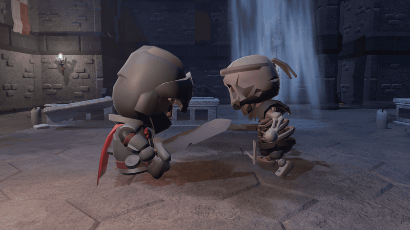 
      <b>Kämpfe, die man lesen kann.</b> Pariere im richtigen Moment und setz den kritischen Stoß. Jeder Angriff
      kündigt sich an.
    </td>
    <td width="50%" valign="top">
      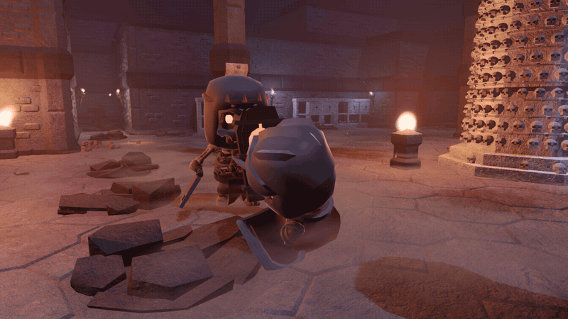 
      <b>Rot heißt: weg da.</b> Rote Angriffe lassen sich nicht parieren – eine Warnglocke gibt dir den Takt zum
      Ausweichen.
    </td>
  </tr>
  <tr>
    <td width="50%" valign="top">
      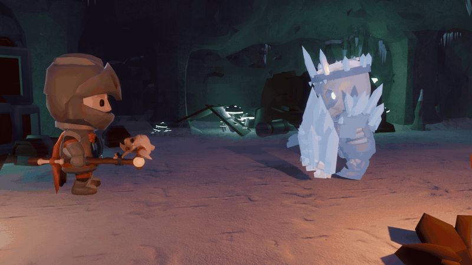 
      <b>Feuer gegen Eis.</b> Der Glutstab schmilzt Eiswände und Schilde, öffnet verborgene Räume und neue Wege.
    </td>
    <td width="50%" valign="top">
      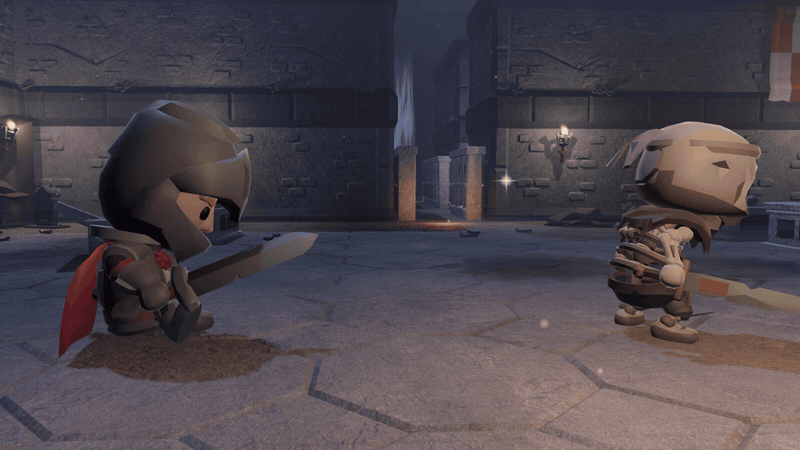 
      <b>Schleichen lohnt sich.</b> Wer unbemerkt von hinten kommt, trifft mit einem Rückenstich – aber nicht
      sprinten.
    </td>
  </tr>
</table>

- **Drei Orte, ein Weg:** eine Gruft voller Scheinmauern und Abkürzungen, ein stilles Refugium unter dem Blutmond und
  die Eishöhlen mit Leitern, Hängebrücken und einem See aus zerbrochenen Schollen.
- **Glutfeuer, Seelen, zweite Chancen:** Rasten heilt und weckt die Toten. Wer fällt, holt seine Seelen an der
  Seelenflamme zurück.
- **Waffen schmieden:** Eidstahl härtet deine Klinge, Glutsplitter stärken den Heiltrank. Dazu Wurfmesser, Ringe und
  ein Verbündeter, den du in die Schlacht rufen kannst.
- **Erfolge und zehn Spielstände:** Erfolge für jedes Gebiet, keiner davon verpassbar – und eine Chronik, die
  festhält, was du erlebt hast.
- **Gemacht für das Steam Deck:** passende Tastensymbole für jeden Controller, gut lesbare Schrift, eine eigene
  Grafikstufe für den Akku – und Updates direkt im Spiel.

## Bilder

<table>
  <tr>
    <td width="50%">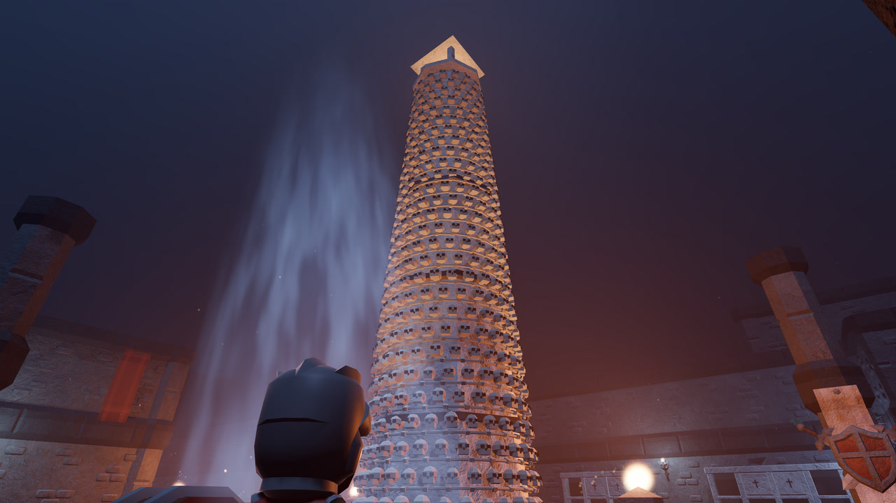</td>
    <td width="50%">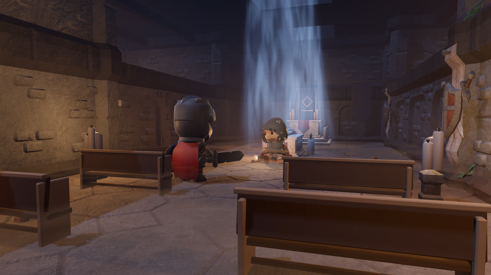</td>
  </tr>
  <tr>
    <td width="50%">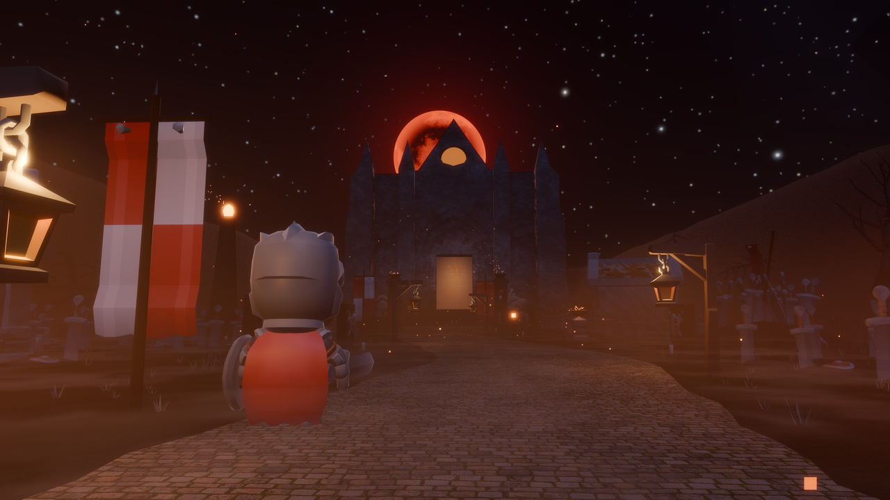</td>
    <td width="50%">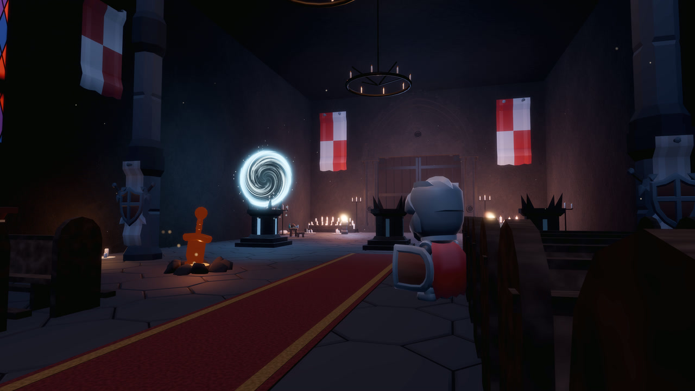</td>
  </tr>
  <tr>
    <td width="50%">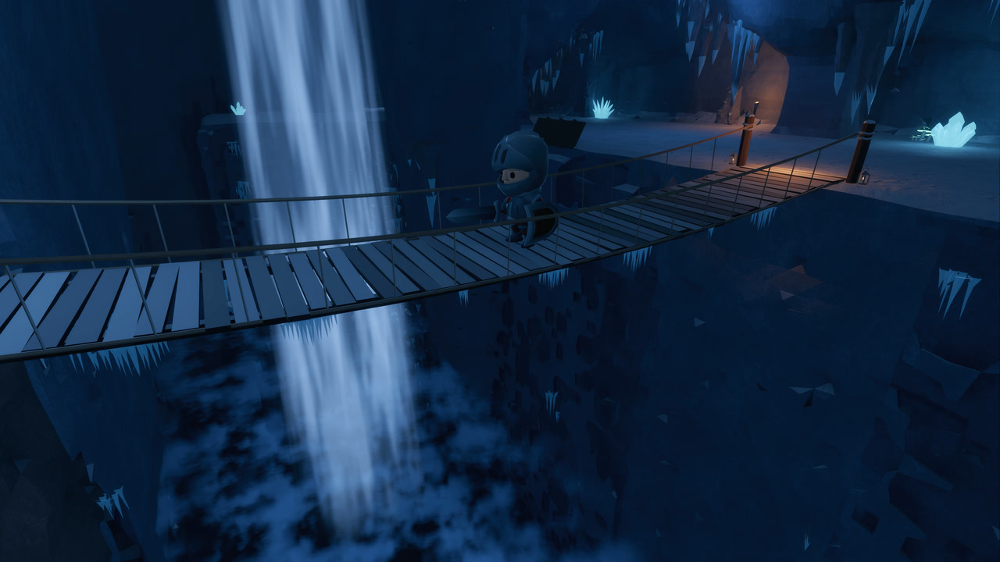</td>
    <td width="50%">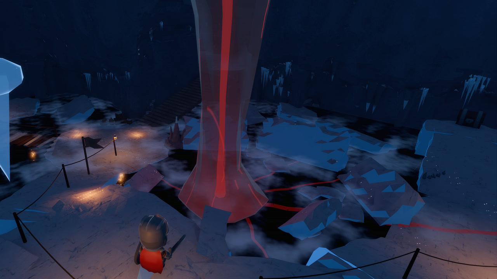</td>
  </tr>
  <tr>
    <td width="50%">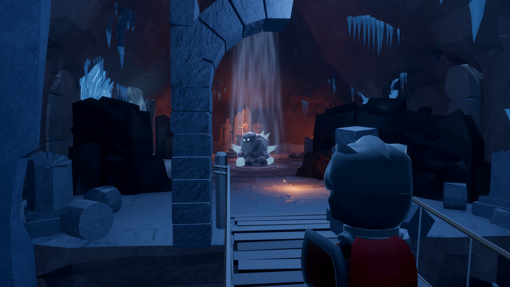</td>
    <td width="50%">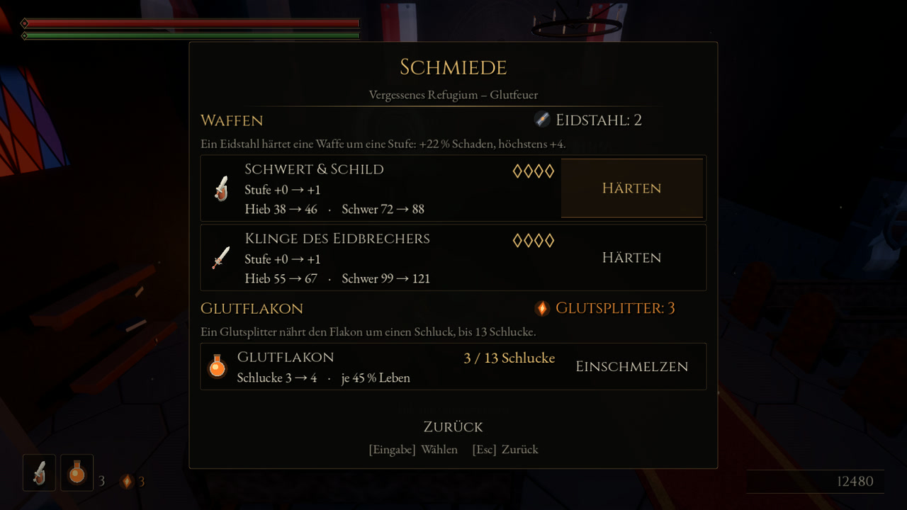</td>
  </tr>
</table>

## Herunterladen und spielen

| System | Datei | Start |
|---|---|---|
| **Windows** 10/11 (64 Bit) | [`Ascheneid-Windows.zip`](https://github.com/KrabbiAI/Ascheneid/releases/latest/download/Ascheneid-Windows.zip) | Entpacken, `Ascheneid.exe` starten (`.exe` und `.pck` im selben Ordner lassen) |
| **Linux** (x86_64) und **Steam Deck** | [`Ascheneid-Linux.zip`](https://github.com/KrabbiAI/Ascheneid/releases/latest/download/Ascheneid-Linux.zip) | Entpacken, `Ascheneid.x86_64` starten |
| **macOS** 11+ (Intel und Apple Silicon) | [`Ascheneid-macOS.zip`](https://github.com/KrabbiAI/Ascheneid/releases/latest/download/Ascheneid-macOS.zip) | Entpacken, `Ascheneid.app` per Rechtsklick → *Öffnen* starten |

<b>Steam Deck:</b> als Nicht-Steam-Spiel einrichten

Im Desktop-Modus die Zip herunterladen und entpacken, z. B. nach `~/Games/Ascheneid`. In Steam *Spiele →
Nicht-Steam-Spiel zur Bibliothek hinzufügen* → *Durchsuchen* → `Ascheneid.x86_64` wählen. Im Spielmodus startet
Ascheneid dann aus der Bibliothek im Vollbild, mit Steam-Deck-Tastensymbolen und einer Grafikstufe für den Akku.
Startet die Datei unter Linux nicht, hilft `chmod +x Ascheneid.x86_64`.

Für eine schöne Bibliothek gibt es ein Art-Pack (Capsule, Hero, Logo, Icon):
[**Ascheneid-SteamDeck-Art.zip**](https://github.com/KrabbiAI/Ascheneid/releases/latest/download/Ascheneid-SteamDeck-Art.zip)
– in Steam per Rechtsklick auf das Spiel → *Eigenschaften* bzw. auf das Bild → *Eigenes Bild festlegen*.

  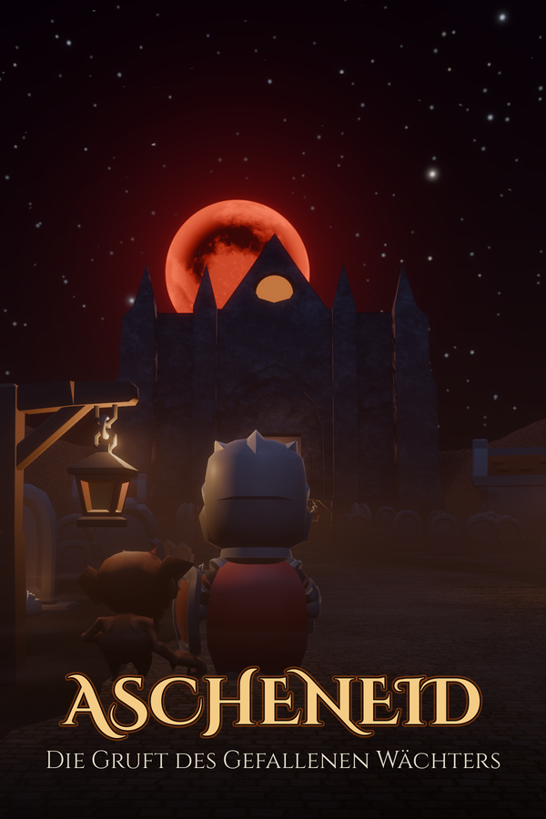
  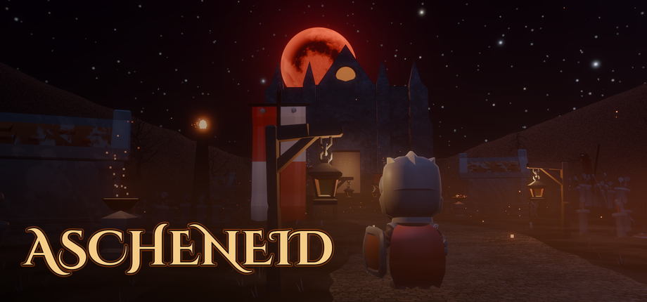

<b>Windows meldet „Der Computer wurde durch Windows geschützt“ / macOS öffnet die App nicht</b>

Ascheneid ist nicht digital signiert. **Windows:** auf *Weitere Informationen* → *Trotzdem ausführen* klicken.
**macOS:** Rechtsklick auf die App → *Öffnen* → *Öffnen*. Hilft das nicht: *Systemeinstellungen → Datenschutz &
Sicherheit → Trotzdem öffnen*, oder im Terminal `xattr -cr Ascheneid.app`.

**Updates** kommen direkt ins Spiel: Beim Start fragt das Titelmenü, ob eine neue Version geladen werden soll;
Spielstände und Einstellungen bleiben erhalten. Ruckelt es auf einem älteren Rechner, hilft *Optionen → Grafik →
Stufe 0*.

### Systemanforderungen

| | Mindestens | Empfohlen |
|---|---|---|
| **System** | Windows 10 (64 Bit), macOS 11, Linux (x86_64), Steam Deck | Windows 11, macOS 13 |
| **Grafik** | integrierte Grafik mit Vulkan (Mac: Metal) | eigene Grafikkarte |
| **Arbeitsspeicher** | 4 GB | 8 GB |
| **Speicherplatz** | ca. 400 MB | ca. 400 MB |
| **Eingabe** | Tastatur und Maus | Controller (Xbox, PlayStation oder Steam Deck) |

<b>Steuerung</b>

Das Spiel erkennt den Controller und zeigt überall die passenden Tastensymbole; im Pausemenü steht die Belegung.

| Aktion | Tastatur/Maus | Xbox / Steam Deck | PlayStation |
|---|---|---|---|
| Bewegen / Kamera | WASD / Maus | linker / rechter Stick | linker / rechter Stick |
| Ausweichen / Sprinten | Leertaste / Umschalt halten | B tippen / halten | Kreis tippen / halten |
| Leichter / schwerer Angriff | linke Maustaste / Q | RB / RT (Deck: R1 / R2) | R1 / R2 |
| Blocken / Parieren | rechte Maustaste / F | LB / LT (Deck: L1 / L2) | L1 / L2 |
| Glutflakon | R | X | Quadrat |
| Interagieren | E | Y | Dreieck |
| Ziel fixieren / wechseln | Tab / Maus seitlich | R3 / rechter Stick | R3 / rechter Stick |
| Schnellleiste | C / X, Mausrad, 1–4 | Steuerkreuz rechts / links | Steuerkreuz rechts / links |
| Inventar / Pause | I / Esc | Ansicht / Menü | Create / Options |

Tastatur und Maus lassen sich unter *Optionen → Steuerung* frei belegen.

## Neu in 1.2: Die Eishöhlen

- Ein ganzes neues Gebiet hinter dem eisblauen Portal – mit dem Glutstab, neuen Gegnern, Frost und einem Weg hinab
  über neun Ebenen.
- Die Gruft ist von Grund auf neu gebaut, rund um das Ossarium und die Kapelle der Eidritter.
- Rückenstich, Eidstahl zum Schmieden, fairere rote Angriffe und bessere Lesbarkeit auf dem Steam Deck.

Alle Änderungen: [CHANGELOG.md](CHANGELOG.md)

## Fehler gefunden?

Melde ihn gern über die [Issues](https://github.com/KrabbiAI/Ascheneid/issues) – am besten mit System,
Version (steht im Titelmenü) und einem Bild.

## Mitwirkende und Lizenzen

Entwickelt von **DobbyLabs** mit Claude (Anthropic), gebaut mit der [Godot Engine](https://godotengine.org). Modelle
von Kay Lousberg (KayKit) und Quaternius, Texturen von Poly Haven, Musik von cynicmusic, Cethiel, yd und César da
Rocha, Klänge und Tastensymbole von Kenney – alle Quellen und Lizenzen stehen in [CREDITS.md](CREDITS.md).
Der Quellcode ist nicht öffentlich; hier gibt es die Spiel-Downloads, die Änderungen und die Bilder.
